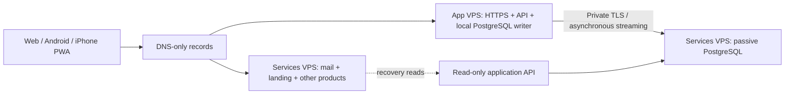

# Two VPSs, one application writer

A practical service-affinity design for a small social application: keep its API
and PostgreSQL writer together, put independent services on the other VPS, and
keep a passive application replica for recovery.

[Русская версия](README.ru.md) · [Architecture](docs/architecture.md) ·
[Operations](docs/operations.md) · [Performance](docs/performance.md)

This repository is a documented case study and a set of configuration examples.
It is not a one-command installer or a claim of automatic lossless failover.
The clickngoal application is at [goal.clickn.dev](https://goal.clickn.dev/), with
its public foundation at [jabrailkhalil/clickngoal](https://github.com/jabrailkhalil/clickngoal).

Normal application traffic stays on the application VPS. Independent services do
not compete for its ordinary API request capacity. A matching static frontend and
a passive database live on the services VPS for outage recovery.

## Why this arrangement?

Adding an HTTP worker on a second machine can make database-heavy requests slower
when the writer remains on the first. In our limited samples, local SQL roundtrips
were about 0.3 ms, while the private inter-server path added about 35–45 ms.
The faster uplink was useful, but database locality was the first problem to fix.

## Failure behavior

| Event | Behavior |
| --- | --- |
| Services VPS fails | Application remains writable on its own VPS |
| Application VPS fails | Reserve can serve previously replicated reads; writes wait for safe recovery |
| Private link fails | Writer stays local; replication-lag monitoring alerts |
| Accidental deletion | Replication repeats it; a replica does not provide historical recovery |

DNS failover changes the entry point. It does not promote PostgreSQL. A failed
ping is not proof the former writer has stopped. Promotion requires verified
fencing, replay checks and an operator-controlled transfer. See
[PostgreSQL's failover guidance](https://www.postgresql.org/docs/18/warm-standby-failover.html).

## Contents

- A topology and explicit failure matrix.
- A planned-transfer checklist, rollback boundaries and disk accounting.
- A measurement plan separating bandwidth, roundtrips, SQL work and UI caching.
- An Nginx example with local writer routing and safe-read fallback.
- A small pure routing policy with tests: `python -m unittest discover -s tests`.

All addresses and domains in examples are placeholders. Credentials, real host
addresses, customer records, application secrets and private operational receipts
are deliberately excluded. Adapt and test the examples before applying them.

MIT licensed. Contributions with reproducible measurements and explicit failure
assumptions are welcome.
